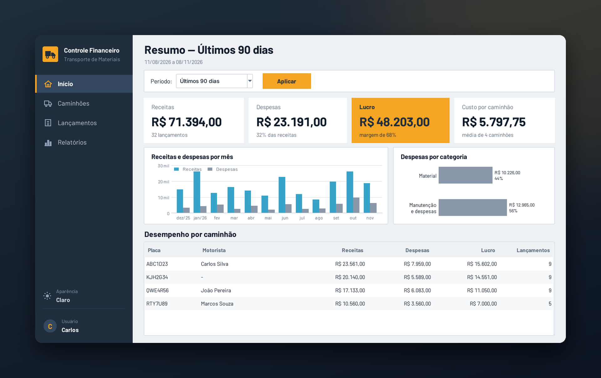
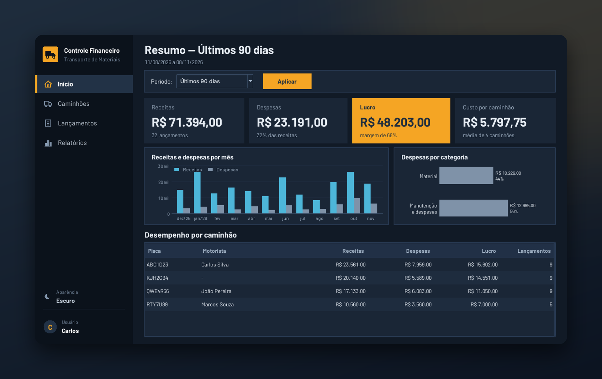
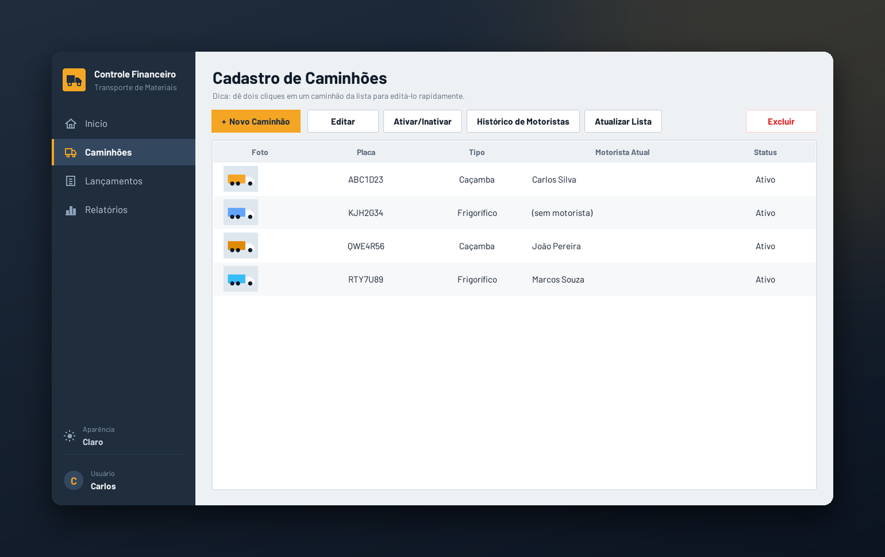
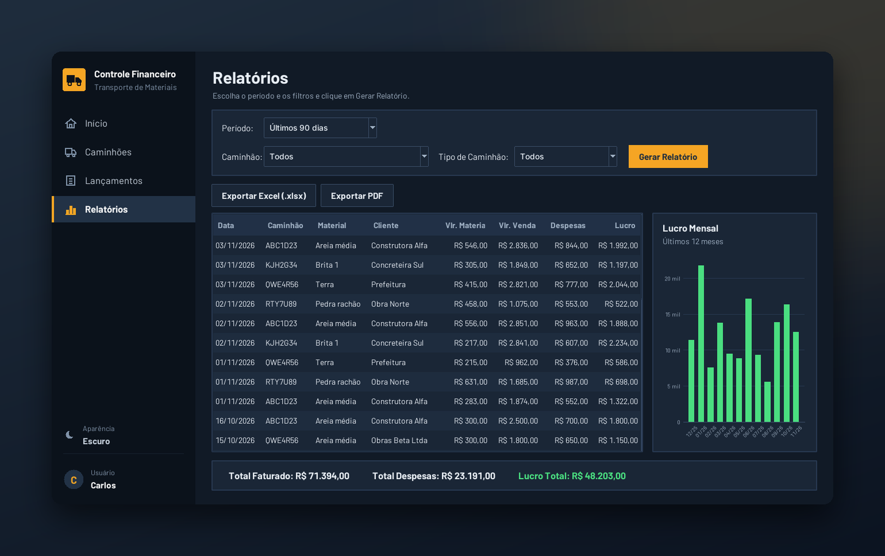
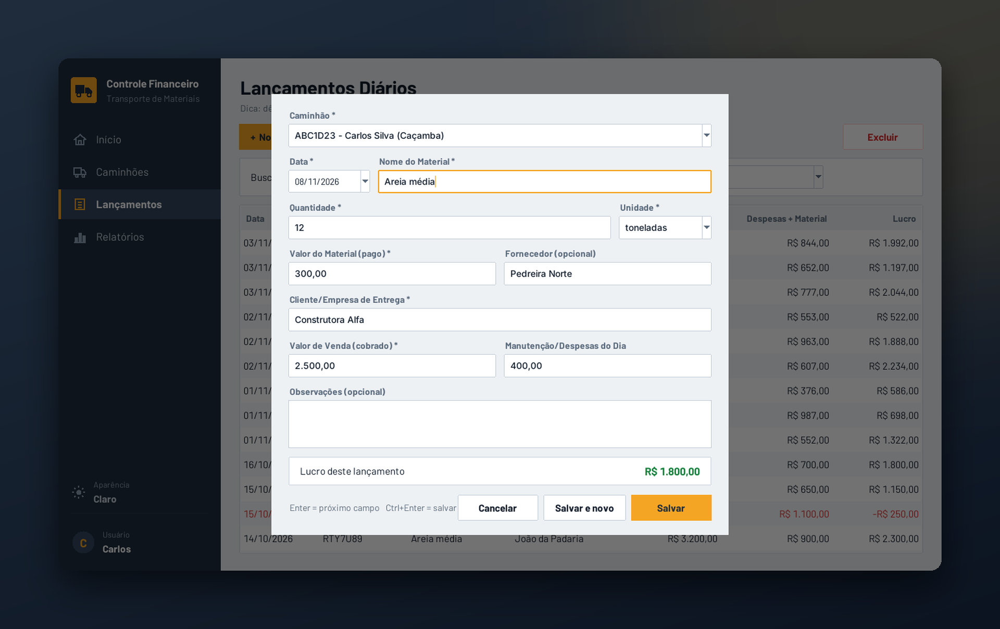
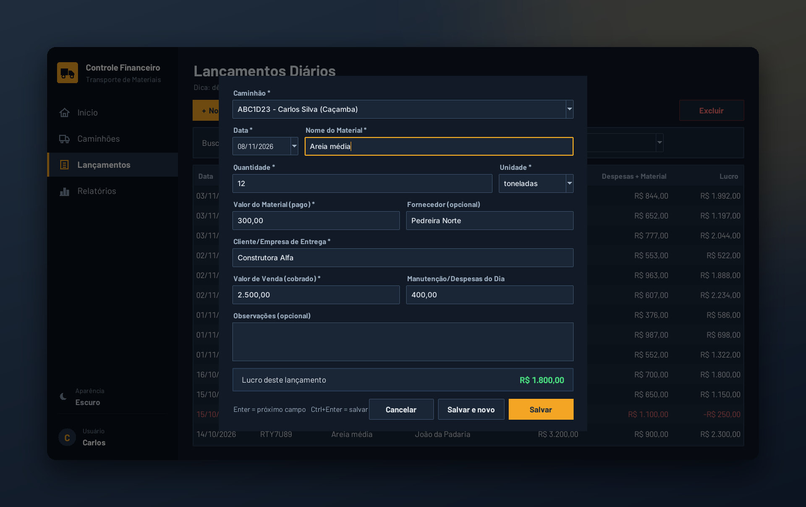

# Controle Financeiro para Frotas

Sistema de controle financeiro para empresas de transporte, que funciona direto no computador, **sem internet** e sem mensalidade de nuvem. Registre os lançamentos do dia, veja o lucro de cada caminhão e gere relatórios em PDF e Excel.

## Como foi feito

Desenvolvido por Lucas Custódio Firmes com auxílio do Claude, da Anthropic.

*Fleet finance control for trucking companies. Runs on your own computer, offline.*

## O que ele faz

- **Painel inicial** com receitas, despesas, lucro e custo por caminhão, mais gráficos por mês e por categoria
- **Cadastro de caminhões** com foto, tipo, motorista atual e histórico de motoristas
- **Lançamentos diários** com formulário rápido, lucro calculado na hora e "Salvar e novo"
- **Relatórios** por período, caminhão ou tipo, com exportação para **Excel e PDF**
- **Modo claro e escuro**, escolhido com um clique
- **Backup automático** e registro de quem alterou o quê

## Telas

| Painel (claro) | Painel (escuro) |
|---|---|
|  |  |

| Caminhões | Relatórios |
|---|---|
|  |  |

| Novo lançamento (claro) | Novo lançamento (escuro) |
|---|---|
|  |  |

> Todos os dados mostrados nas imagens são fictícios.

## Quer um sistema assim para o seu negócio?

Faço instalação e adaptação sob medida.
Contato: **lucfirmes@gmail.com**

---

© Lucas Custódio Firmes. Todos os direitos reservados. Este repositório contém apenas capturas de tela de demonstração; o código-fonte é privado e não está disponível para cópia, uso ou redistribuição.
